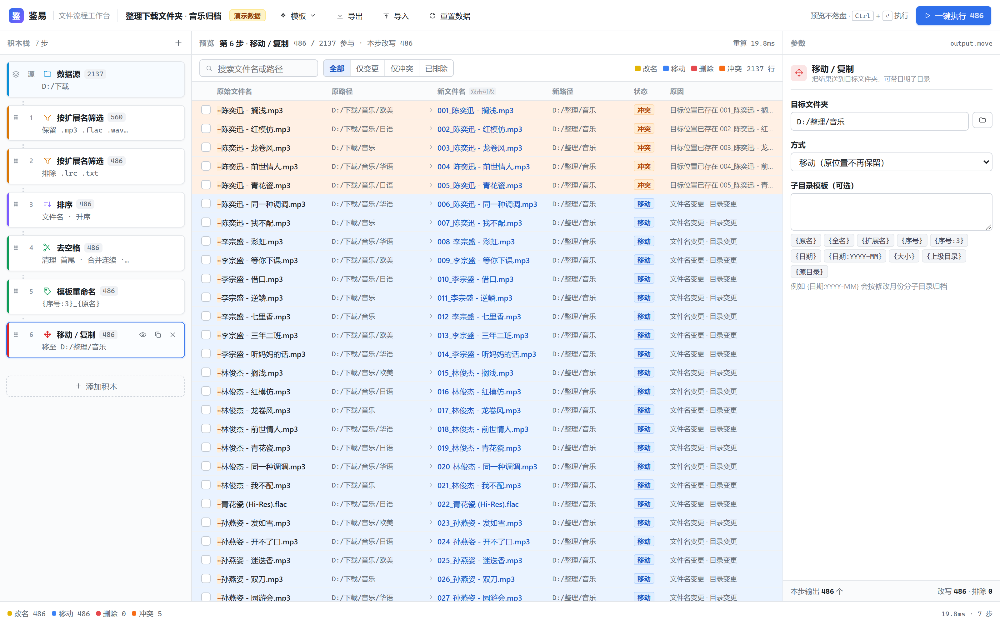
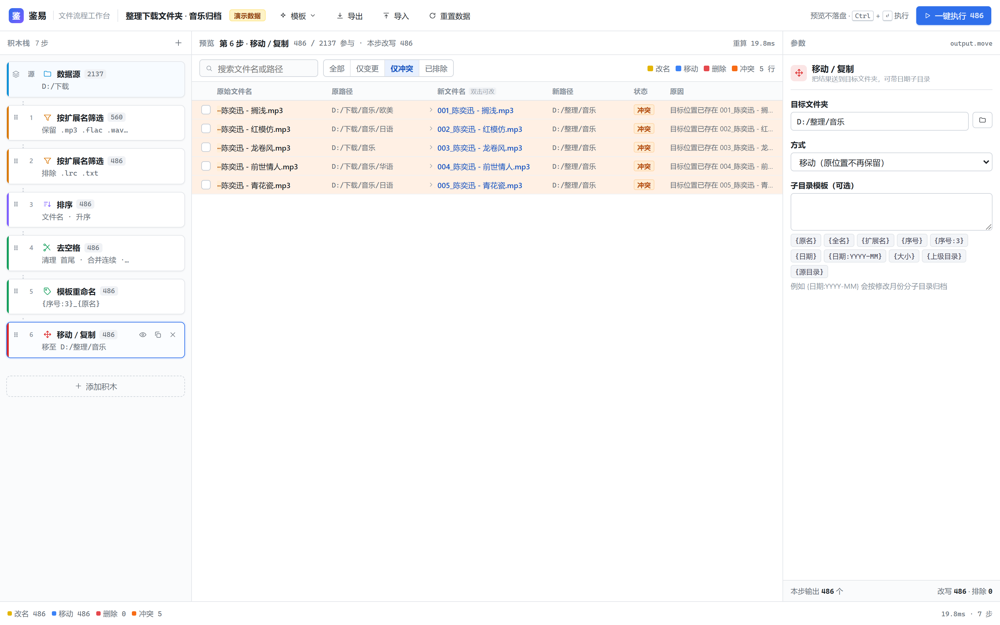
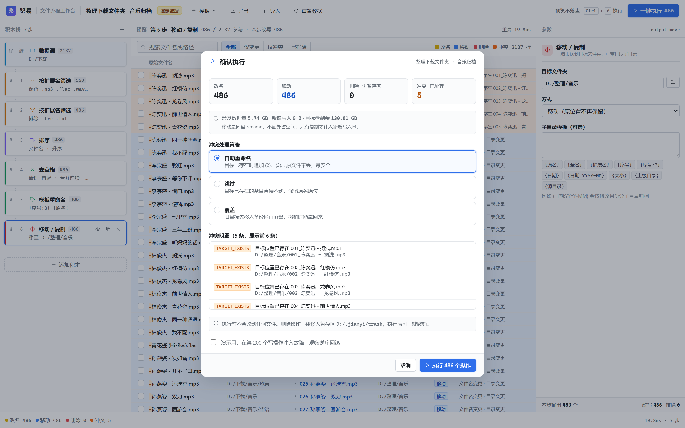

# 鉴易 · 低代码可视化文件处理工作台

> 用鼠标把积木拖成一条文件处理流水线 —— **每一步都能实时预览结果，看清楚了才落盘，落完盘还能一键撤销。**

鉴易不是批量重命名工具，也不是同步盘。它解决的是那类"我知道要干什么，但不敢下手"的活：几千个文件名乱成一锅粥，想整理，可一旦跑错就得熬夜恢复。

**一句话原则**：积木栈从不碰磁盘。它只被编译成一份「变更计划」，你看到的那张大表格就是这份计划的可视化；只有点「一键执行」，计划才真正落盘。

---

## 它和现有工具的区别

| 你现在的做法 | 鉴易 |
| --- | --- |
| 写个 Python 脚本 `os.rename` 直接改，改错只能翻备份 | 先"预演"：落盘之前就能看到 2000 行的前后对照 |
| 资源管理器里一屏一屏手动看 | 一张表看完所有文件的「原名 → 新名 / 原目录 → 新目录」 |
| 改名工具只管改名，移动还得另找一个 | 排序 / 筛选 / 改名 / 移动 / 复制 / 删除串成一条流水线，一步接一步 |
| 执行到一半失败，一半文件在旧位置一半在新位置 | 失败即停 + 逆序回滚，自动回到执行前 |
| 后悔了 | 撤销按钮，一次撤掉整批操作 |
| 冲突靠肉眼查：会不会撞名？会不会覆盖？ | 两层冲突检测，撞名在计划阶段就标红，执行前就能定策略 |

---

## 界面：三栏，从左到右就是一条时间线



| 栏 | 是什么 |
| --- | --- |
| **左 · 积木栈** | 从上到下就是执行顺序，拖动可调。每张卡片上实时显示「这一步还剩多少文件」 |
| **中 · 逐级预览** | 点左边任意一块，这里立刻切到「这一步的输出」。表格是 原文件 → 变更后 的完整对照 |
| **右 · 参数面板** | 选中积木的全部参数。改任意一项，中栏 100ms 内重算 |

顶部有执行、导出计划、导入计划、重置；底部状态栏只留全局计数（改名 / 移动 / 删除 / 冲突）和本次编译耗时。

---

## 能做什么

### 十种积木

| 分类 | 积木 | 参数 |
| --- | --- | --- |
| 数据源 | **数据源** | 文件夹路径（递归扫描）。全局唯一，恒在首位 |
| 排序 | **排序** | 按文件名 / 扩展名 / 大小 / 修改日期 / 原路径，升序或降序 |
| 筛选 | **按扩展名筛选** | 保留或排除指定扩展名列表 |
| 筛选 | **条件筛选** | Glob、正则、大小区间（KB）、修改日期区间，可组合 |
| 变换 | **去空格** | 首尾 / 开头 / 结尾；合并连续空格；处理全角空格 |
| 变换 | **大小写** | 全小写 / 全大写 / 词首大写 / 句首大写；作用在名字、扩展名或两者 |
| 变换 | **查找替换** | 纯文本或正则，支持 `$1` 反向引用 |
| 变换 | **模板重命名** | `{序号}` `{原名}` `{扩展名}` `{日期}` `{大小}` `{上级目录}` `{原目录}`，序号可设起始值、位数、排序依据 |
| 输出 | **移动 / 复制** | 目标目录 + 可选子目录模板；移动时可选"目标已存在"的策略 |
| 输出 | **删除** | 匹配 Glob 的删除，或删除全部剩余（一律进暂存区，永不真删） |

### 几个不显眼但很要紧的能力

- **逐级预览，而不是只看最终结果。** 一条 7 步的流水线，中间每一步都能点开看 —— 因为大多数错误发生在中间，不在终点。
- **两层冲突检测。** 步骤内校验（正则写错、模板缺 `{原名}` 导致重名）给即时红字；编译末尾做全局检测：目标已存在、批内重名、大小写撞车、只改大小写、目标是自己、磁盘空间不足。
- **冲突策略在计划阶段就应用。** 跳过 / 覆盖 / 自动加序号，改完策略立刻重算 —— 所以"预演"是真的预演，不是估算。
- **单个文件手动改写。** 双击表格里的新文件名或新目录，直接改。改完这一条就固定下来，优先级高于所有积木，但仍然要过全局冲突检测。
- **单个文件排除。** 行首那枚 ×，点了它就退出后续所有步骤，但**仍然留在表里**（灰掉、标「已排除」），随时点回来。磁盘上一直没动过。
- **删除只是搬家。** 所有"删除"都进暂存区 `<appData>/trash`，同名自动加 `(2)` 不覆盖。撤销就是把它们搬回来。
- **撤销是一条命令。** 执行完生成 journal，按逆序回滚。执行中失败也走同一套回滚逻辑。
- **计划可导出/导入。** 一条流水线就是一个 JSON，能存下来复用、发给同事。
- **演示模式与真磁盘同构。** 没选文件夹时用内置的 2137 个文件演示，界面完全一致（只是打个黄标），不用准备素材就能上手。

### 冲突长这样



5 个文件要落到 `D:/整理/音乐` 里已经存在的同名文件上。左边标红、右边写明「目标位置已存在 xxx」，执行弹窗里再让你决定是跳过、覆盖还是自动加序号。

### 执行前最后一道闸



改名 486 / 移动 486 / 删除 0 / 冲突 5，下面逐条列出 5 条冲突明细，还会提示预计移动体积、目标盘剩余空间、暂存区位置。勾上「在第 200 个写操作注入故障」可以直接演练回滚。

---

## 快速开始

### 用现成的 exe

直接下载仓库里的 [`release/鉴易.exe`](release/鉴易.exe)（3.8 MB），双击即用。

单文件，免安装，不写注册表 —— 放到哪都能跑，删掉就是卸载。

> 依赖系统自带的 WebView2（Win11 自带；Win10 若提示缺失，装一次 [WebView2 Runtime](https://developer.microsoft.com/microsoft-edge/webview2/) 即可）。

### 从源码跑

```bash
npm install
npm run dev        # 浏览器打开 http://localhost:5183
```

打开就已经载入内置模板「整理下载文件夹 · 音乐归档」，直接可以玩。

```bash
npm run check      # 不启浏览器，纯 Node 跑一遍内核：逐级读数 / 冲突 / 执行 / 撤销 / 故障注入
```

---

## 从源码构建桌面版

需要 Rust。**只跑浏览器版的话完全不用装。**

```bash
# 1. 装 Rust（已装可跳过）
winget install -e --id Rustlang.Rustup

# 2. 构建（首次要编 400+ 个 crate，约 10~20 分钟）
npm install
npm run tauri build -- --no-bundle
```

产物：`src-tauri/target/release/鉴易.exe` —— 单个可执行文件，前端资源已经嵌进去了。

国内网络建议先配两个镜像，否则拉工具链和 crate 会非常慢：

```powershell
# rustup 镜像（临时环境变量，只影响本次）
$env:RUSTUP_DIST_SERVER = "https://mirrors.tuna.tsinghua.edu.cn/rustup"
$env:RUSTUP_UPDATE_ROOT = "https://mirrors.tuna.tsinghua.edu.cn/rustup/rustup"
```

```toml
# ~/.cargo/config.toml —— cargo 拉 crate 走的是另一套配置
[source.crates-io]
replace-with = "tuna"
[source.tuna]
registry = "sparse+https://mirrors.tuna.tsinghua.edu.cn/crates.io-index/"
```

开发调试用 `npm run tauri dev`（真窗口 + 真磁盘）。三个容易卡住的点：`devUrl` 端口必须和 vite 一致（本项目固定 5183，`strictPort: true`）；`rustc -vV` 的 host 必须是 `x86_64-pc-windows-msvc`（`-gnu` 说明没找到 MSVC）；装完 rustup 必须重开终端才认 PATH。

---

## 内置演示数据

内存文件系统里模拟了一个真实的 `D:/下载`：

- **2137 个文件**（不含 7 个隐藏文件）：音频 486、歌词 61、说明 13、图片 902、视频 178、压缩包 264、其他 233
- 其中 **137 个**文件名带首尾空格、连续空格或全角空格
- 目标目录 `D:/整理/音乐` 预置了 5 个同名文件，用来演示冲突检测

内置模板跑完的读数：

```
2137 → 560 → 486 → 486 → 486 → 486 → 486
```

前两步在筛（1577 + 74 个被排除），后四步在改写（137 个去空格、486 个加序号、486 个移动）。整条流水线编译一次 **约 10ms**。

---

## 几条不可动摇的设计决定

| 决定 | 理由 |
| --- | --- |
| 删除 / 筛选**只改 status，不摘数组元素** | 行 key 稳定、虚拟滚动不跳行、计划 = origin↔cur 的纯 diff |
| 改名 + 移动同时发生 = **一条 move** | 落盘就是一次 `rename()`，拆两条会造出不存在的中间状态 |
| 冲突策略在**计划阶段**就应用 | 否则「预演」是假的，改策略也不能立刻重算 |
| 删除**一律进暂存区**，永不真删 | 不依赖系统回收站 API（三平台行为不一致），行为一致且必然可撤销 |
| 执行失败**即停 + 逆序回滚** | 半成品状态比"少做了几个"更难善后；正序回滚会在链式改名上互相踩 |
| 手动改写**只作用于终态**，不进逐级缓存 | 它是覆盖层，不是积木；进缓存会让"第 3 步预览"变成谎言 |
| `core` 不 import React / DOM | 真机阶段整块搬进 Web Worker 零改动 |

---

## 结构

```
src/
  core/                    纯函数层：零 DOM / 零 React / 零 adapter 实现
    model/                 item（条目模型）、plan（变更计划）、pipeline（项目文件）、journal
    steps/                 10 种积木，每种一个纯函数 + 参数声明
    engine/                compile（编译主循环）、stageCache（增量）、conflicts（两层检测 + 策略）
    exec/                  preflight、executor（串行落盘）、rollback（逆序回滚）
    mock/                  演示数据集与内置模板
  platform/                适配层：唯一跨层契约
    types.ts               PlatformAdapter（13 个方法）
    mock/memoryAdapter.ts  内存文件系统，可注入故障
    tauri/tauriAdapter.ts  真磁盘，每个方法一条 Rust 命令
  state/                   zustand store + 编译调度（debounce / runId）
  ui/                      三栏界面：积木栈 / 虚拟滚动预览表 / 参数面板 / 状态栏 / 执行弹窗
src-tauri/                 Rust 后端（Tauri 2）
  src/fs.rs                13 个文件系统命令 + 15 个单元测试
docs/design-spec.html      设计方案（布局线框、数据结构、状态流转、端到端演示）
scripts/                   内核自检、浏览器验收、真磁盘端到端
```

**业务逻辑一行都没为桌面版改过** —— 只换了适配器实现，外加把写死的 `MemoryAdapter` 类型放宽成 `PlatformAdapter`。

### 为什么文件操作全在 Rust 侧

一次扫描 2000+ 文件，如果每个文件往返一次 IPC，光序列化就吃掉几百毫秒。所以「递归遍历 + stat」压进一个 `scan_dir` 命令，一次 IPC 拿回整个目录树。

---

## 验证

三层，都能自己跑：

```bash
npm run check                                          # 内核自检：编译耗时、计划、执行、撤销、故障注入
cargo test --manifest-path src-tauri/Cargo.toml --lib   # 15 个用例：扫描/移动/暂存/还原/大小写/尾随空格
node scripts/e2e-tauri.mjs                             # 端到端：接管真实窗口，在真磁盘上跑完整流程
```

端到端那层通过 WebView2 的远程调试口接管原生窗口，真的建目录、扫描、改名、移动、撤销，然后直接读磁盘校验结果：

```bash
npx tauri dev --config src-tauri/tauri.test.conf.json
```

---

## 还没做

- **崩溃恢复。** journal 目前只在内存里。要每条 flush 到 `<appData>/journal.jsonl`，启动时检测未完成记录并提示恢复 —— 这是断电/强杀后能救回半成品的关键。
- **把 core 搬进 Worker。** core 至今不 import React/DOM，整块搬过去零改动。十万文件级别再考虑。

## 明确不做

- 不做文件监控 / 自动触发（那是 Hazel、File Juggler 的领域）
- 不做分支 DAG（线性栈够用；真要分支，内部编译成 DAG，对外仍只呈现「步骤」）
- 不做百万级文件（目标万级，当前 2137 × 7 步 = 10ms 量级）
- 不做真删、不接系统回收站
- 不做云同步与多人协作
